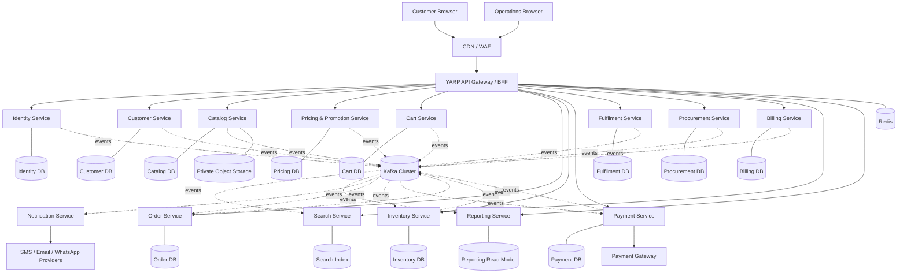

**Document ID:** SCP-ARCH-001  
**Version:** 1.0  
**Prepared:** 02 November 2026  
**Status:** Baseline specification — client decisions and security review required before production go-live  
**Product type:** New, standalone supermarket commerce platform  
**Backend:** ASP.NET Core Web API on .NET 10 LTS  
**Frontend:** Angular 22  
**Architecture:** Independently deployable microservices, event-driven integration  
**Primary database:** PostgreSQL  
**Event streaming:** Apache Kafka  
**Distributed cache:** Redis

---

### 0. How to use this document

This document is the source of truth for the Codex-assisted implementation. Codex must read this file and the repository `AGENTS.md` before changing code. The specification describes target behavior and architecture; it does not claim that any software has already been implemented, tested, penetration-tested, or certified.

Build the system incrementally. Do not generate every service as empty boilerplate and call the system complete. Each phase must compile, pass its required tests, include migrations and operational documentation, and be reviewed before the next phase begins.

#### Key words

- **MUST / MUST NOT:** mandatory requirement.
- **SHOULD / SHOULD NOT:** strong recommendation; deviations need a written Architecture Decision Record (ADR).
- **MAY:** optional, subject to client approval.
- **Store / branch:** a physical supermarket location with its own stock, staff scope, operating hours and delivery/pickup settings.
- **Customer storefront:** the public Angular shopping experience.
- **Operations portal:** restricted Angular application for administrators, managers and store staff.

### 1. Product vision and scope

Build a commercial-grade online ordering platform for a real supermarket operator. Customers browse products, search, check branch availability, add items to a cart, select delivery or pickup, pay online or choose cash on delivery where enabled, track orders and request eligible cancellations/returns. Store staff manage catalogues, prices, stock, batches and expiry, purchase receipts, picking, packing, dispatch, refunds and reports.

The platform is designed for one supermarket business with one or more branches. Branch separation is a first-class business boundary. A future multi-merchant SaaS model is **not** assumed in the first release and must not be added casually; it requires a separate tenant-isolation ADR.

#### 1.1 Goals

1. A fast, responsive customer shopping experience on desktop and mobile browsers.
2. Secure staff/admin operations with least-privilege and branch-scoped permissions.
3. Correct stock reservation and order processing under concurrent checkout traffic.
4. Batch/lot and expiry management for perishable products, with FEFO allocation where configured.
5. Reliable payment, webhook, refund, invoice and order state handling.
6. Independently deployable backend microservices with clear data ownership.
7. Kafka-based asynchronous integration with retry, idempotency, dead-letter handling and replay procedures.
8. Redis used for measured cache, ephemeral state and distributed coordination—not as the financial or stock system of record.
9. Runtime configuration for prices, tax classes, delivery fees, limits, promotions, branch settings, feature flags and content. No business rules embedded as constants in source code.
10. Automated tests, CI/CD, observability, backup/restore and operational runbooks suitable for a real client handover.

#### 1.2 In scope — first commercial release

- Customer registration, login, email/phone verification and profile management.
- Address book and address serviceability validation.
- Branch/store configuration, service hours and delivery/pickup availability.
- Product catalogue, categories, brands, SKU/barcode, images, units of measure, attributes and active/inactive status.
- Product search, filters, sorting and pagination.
- Branch stock visibility and out-of-stock handling.
- Configurable price lists, promotions, coupons and offer eligibility.
- Cart, checkout, delivery/pickup slot selection and order placement.
- Inventory reservation, batch allocation and stock ledger.
- Online payment provider integration and configurable COD.
- Order lifecycle, picking, packing, substitutions (subject to customer consent), dispatch, pickup and delivery tracking.
- Cancellation, returns, refunds and credit notes with approvals and audit.
- Supplier records, purchase orders, goods receipt and stock intake.
- Tax/invoice configuration and invoice generation; statutory integrations only after client/accountant review.
- Customer notifications through pluggable email/SMS/WhatsApp providers.
- Admin, branch manager, inventory, picker/packer, delivery and customer-support workflows.
- Operational dashboards, sales/stock reports and audit trail.
- Responsive Angular customer storefront and restricted operations portal.

#### 1.3 Explicitly out of scope unless separately approved

- Native Android/iOS applications.
- A full general-ledger accounting/ERP system.
- Franchise marketplace or multiple independent merchants.
- Owning a payment-card vault or storing raw card details.
- Building a proprietary delivery-driver navigation network.
- AI recommendations, dynamic pricing, advanced loyalty, subscription boxes and marketing automation.
- Direct integration to every POS/accounting/ERP vendor. Use documented adapter interfaces and implement a named integration only after the client supplies its system/API details.

### 2. Business discovery decisions required from the client

These values MUST be confirmed during discovery and stored as configuration, not assumed in code:

| Decision | Required client input |
|---|---|
| Business footprint | Number of branches now and expected in 24 months |
| Operating model | One stock pool or independent stock per branch |
| Fulfilment | Delivery, pickup, both; delivery radius and service zones |
| Delivery capacity | Slot duration, per-slot capacity, cut-off and blackout periods |
| Product sale units | Piece, pack, kg, gram, litre, ml, variable-weight goods |
| Perishables | Batch/lot tracking, expiry requirements, minimum remaining shelf life |
| Pricing | Same price for all branches or branch-specific price lists |
| Promotions | Coupon stacking, product/category offers, limits and approval rules |
| Payment | Payment gateway, UPI/cards/net banking/wallets, COD, refund provider |
| Tax/invoicing | Legal entity, GST registrations, invoice numbering, tax rules and integration obligations; accountant must approve configuration |
| Customer verification | OTP channel, age/restricted-product rules if applicable, consent text |
| Notifications | Approved SMS, email and WhatsApp vendors and sender/template registrations |
| Languages | English, Marathi, Hindi or other supported locales |
| Currency/timezone | Business currency and branch timezone (India is assumed only as a provisional deployment default) |
| Existing systems | POS, accounting, barcode scanners, label/weight scales, ERP and data import formats |
| Traffic | Peak concurrent users, orders/hour, average basket size and seasonal peaks |
| Service levels | Business hours, availability objective, support hours, RPO and RTO |
| Hosting | Cloud/provider/region, data residency, budget and managed-service preferences |

A signed discovery record must capture the selected values and who approved them. Do not let Codex invent client-specific tax percentages, payment credentials, delivery rules, legal text or production limits.

### 3. Technology baseline

Use supported, pinned and security-patched versions. The versions below are the baseline as of 02 November 2026; the engineering lead must verify the latest servicing patch and package compatibility when creating the repository.

| Area | Required baseline | Implementation notes |
|---|---|---|
| Backend runtime | .NET 10 LTS / ASP.NET Core 10 | Use the latest supported .NET 10 patch at build/release time. Do not start on .NET 8 or .NET 9. |
| Language | C# 14 (aligned with .NET 10 SDK) | Enable nullable reference types and implicit usings; warnings treated seriously. |
| Frontend | Angular 22 + compatible TypeScript | Use the latest supported Angular 22 patch available at implementation time; commit `package-lock.json`. |
| API Gateway | YARP | Single controlled public entry point; route to private service endpoints. |
| ORM | Entity Framework Core 10 + Npgsql provider | Each service owns its `DbContext`, migrations and credentials. |
| Relational store | PostgreSQL, currently supported major release | Prefer managed PostgreSQL for production; test exact major/provider compatibility. |
| Event streaming | Apache Kafka, KRaft mode | Use supported production release, TLS/SASL, ACLs, replication and monitored consumer groups. |
| Cache | Redis | Use a commercially approved/managed Redis offering and confirm its applicable licence/terms for the deployment model. |
| Search | PostgreSQL full-text initially; OpenSearch optional | Introduce a separate search engine only if measured relevance/scale requires it. |
| Object storage | S3-compatible storage or cloud object storage | Product images and generated documents; private buckets and signed access. |
| Containers | Docker | Multi-stage, non-root, minimal runtime images. |
| Orchestration | Kubernetes for production target | Managed Kubernetes preferred. Docker Compose is for local development, not a production HA plan. |
| Observability | OpenTelemetry, Prometheus, Grafana, centralized logs | Trace HTTP and Kafka flows using correlation/trace context. |
| API docs | OpenAPI | Publish per-service internal specs; gateway aggregates approved public contracts. |
| CI/CD | GitHub Actions or client-approved CI | Build, test, scan, produce SBOM, sign and deploy immutable images. |
| IaC | Terraform (or client-standard IaC) | Reproducible environments and reviewed infrastructure changes. |
| E2E testing | Playwright | Customer and operations critical journeys. |
| Load testing | k6 | Model realistic browse/search/checkout and peak traffic. |

.NET 10 is the LTS baseline and is supported through November 2028 according to Microsoft's support policy. Angular 22 is the active Angular major line on the date of this specification. Confirm exact patch versions before implementation and keep the lockfiles committed. See References.

### 4. Architecture principles

1. **Microservices are mandatory.** Each service is a separately buildable and deployable process with an independently owned data store.
2. **Database per service.** No cross-service SQL joins, database credentials or direct reads/writes. Share data through APIs or events.
3. **API Gateway only at the edge.** The Angular apps must not call private service URLs directly.
4. **Event-driven by default for business integration.** Use synchronous HTTP only when the caller needs an immediate answer to complete the current interaction. Avoid long chains of synchronous calls.
5. **Eventual consistency is explicit.** UI must communicate pending states rather than show false success.
6. **Outbox/Inbox and idempotency.** A database commit and its event publication must not be a fragile dual write.
7. **Security at every service boundary.** Authentication at the edge is not sufficient; services validate caller identity/claims and enforce authorization for their own resources.
8. **Configuration over constants.** Rules, prices, limits, tax classes, supported providers, delivery zones and display settings are data/configuration with validation and audit.
9. **Resilience without hiding failures.** Apply timeouts, bounded retries, circuit breakers and dead-letter workflows. Never retry non-idempotent operations blindly.
10. **Operationally observable.** Every request/order/payment/event must be traceable using safe identifiers.
11. **Incremental architecture.** Do not introduce CQRS, distributed locks, Elasticsearch, service mesh or Kubernetes operators without a justified requirement and ADR.
12. **No production claim without evidence.** Passing compilation is not production readiness.

### 5. High-level system topology



The diagram is logical, not an instruction to expose every service publicly. In production, the gateway and approved webhook ingress are public; service pods, Kafka, Redis and databases live on private networks.

### 6. Microservice boundaries and ownership

The initial platform consists of the following deployable services. Each service MUST have its own repository folder, build pipeline, health endpoints, configuration, migration history, database identity and deployment manifest. A shared monorepo is acceptable; shared runtime deployment or shared database ownership is not.

| Service | Main responsibility | Owns its data | Important events |
|---|---|---|---|
| API Gateway / BFF | Public routing, BFF session, edge limits, request correlation | No business DB; optional distributed session in Redis | None as business owner |
| Identity Service | Staff/customer identity, credentials, MFA, roles, permissions, sessions | Users, credentials metadata, roles, permissions, sessions, refresh-token families | `UserRegistered`, `UserStatusChanged`, `RolePermissionsChanged` |
| Customer Service | Customer profile, addresses, consent and saved preferences | Customer profiles, address book, preferences, consent records | `CustomerCreated`, `AddressChanged`, `ConsentChanged` |
| Catalog Service | Product master, categories, brands, SKU/barcode, units, media metadata | Products, variants/SKUs, category tree, attributes, media metadata | `ProductCreated`, `ProductUpdated`, `ProductStatusChanged` |
| Pricing & Promotion Service | Price lists, branch price overrides, coupons, offers, tax-class references | Price lists, price history, promotion rules, coupon issuance/redemption | `PriceChanged`, `PromotionActivated`, `CouponRedeemed` |
| Inventory Service | Stock ledger, branch stock, lots/batches, expiry, reservations, adjustments | Stock ledger, balance projection, batches, reservations, stock counts | `InventoryReserved`, `InventoryReservationRejected`, `StockChanged`, `BatchExpiring` |
| Cart Service | Customer cart, cart lines, saved cart state | Carts, cart lines, cart version, cart expiry | `CartCheckedOut`, `CartAbandoned` (optional) |
| Order Service | Order aggregate, checkout saga, state machine, cancellation requests | Orders, immutable price/tax snapshots, order lines, saga state, idempotency records | `OrderCreated`, `OrderConfirmed`, `OrderCancelled`, `OrderReadyForFulfilment` |
| Payment Service | Payment intents, provider adapter, callbacks/webhooks, refunds | Payment attempts, provider references, webhook receipts, refund state | `PaymentPending`, `PaymentAuthorized`, `PaymentCaptured`, `PaymentFailed`, `RefundCompleted` |
| Fulfilment Service | Delivery/pickup slot capacity, picking, packing, substitutions, dispatch, delivery status | Fulfilment tasks, slot capacity, picker assignments, delivery status | `PickingStarted`, `OrderPacked`, `OrderDispatched`, `OrderDelivered`, `PickupCompleted` |
| Procurement Service | Suppliers, purchase orders, goods receipt, supplier invoices metadata | Suppliers, purchase orders, GRNs, received batch metadata | `PurchaseOrderApproved`, `GoodsReceived` |
| Billing Service | Tax/invoice snapshots, invoice numbers, credit notes and invoice PDFs | Invoices, credit notes, numbering series, tax calculation snapshots | `InvoiceIssued`, `CreditNoteIssued` |
| Search Service | Customer-facing product search, indexing and facets | Search index only; derived projection | `SearchIndexUpdated` (internal) |
| Notification Service | Template delivery, preferences, retries and provider adapters | Templates, delivery attempts, provider references, suppression list | `NotificationSent`, `NotificationFailed` |
| Reporting Service | Read-optimized operational dashboards and report snapshots | Derived reporting/read-model tables | No authoritative business events |

#### 6.1 Service ownership rules

- Catalog owns product descriptive data. Pricing owns sell prices and promotion rules. Inventory owns on-hand/reserved quantities. Do not duplicate ownership by writing the same field in multiple services.
- A search document is a projection, never the authoritative product record.
- Order lines store immutable snapshots of product name/SKU, unit, quantity, unit price, discount and tax calculation inputs/outputs at purchase time. Later catalogue edits must not rewrite history.
- Payment records store provider IDs and states, not raw card numbers, CVV or authentication secrets.
- Billing stores legally relevant invoice snapshots. Invoice numbers must be generated atomically within the approved legal entity/series/financial-year scope.
- Reporting consumes events or approved APIs and must never run cross-database joins against live service databases.

#### 6.2 Service communication

**Synchronous REST:** immediate validation/quote needed by a screen (for example, serviceability, current price quote or branch selection). Use short timeouts and no unbounded fan-out.

**Kafka events:** lifecycle integration (product changed, stock changed, reservation result, payment captured, order confirmed, fulfilment delivered, invoice issued). Consumers must be idempotent.

**Internal gRPC:** MAY be used for proven high-volume internal request/response traffic after measurement. Do not introduce it by default. REST + Kafka is the initial standard.

### 7. Domain workflows and invariants

#### 7.1 Product lifecycle

1. Authorized catalogue staff create a product/SKU with required identifiers, UOM, category, tax class reference, storage requirements and selling status.
2. Validation checks SKU/barcode uniqueness, UOM compatibility, mandatory perishable metadata and image metadata.
3. Media is uploaded through a controlled upload flow to private object storage. The API stores only the object key/metadata.
4. Product activation emits `ProductCreated` or `ProductUpdated` through the transactional outbox.
5. Search consumes the event and updates its projection. Cache keys are invalidated/versioned.
6. Branch availability and price are resolved from their owning services, not hardcoded on the product record.

#### 7.2 Price quote and cart

- Cart totals shown in the browser are estimates only; the server is authoritative.
- The browser sends SKU, quantity, selected branch, coupon code and delivery method. It MUST NOT send trusted unit price, discount, tax total or payable amount as authoritative values.
- Pricing service validates price list, effective dates, branch scope, customer eligibility, coupon limits, stacking rules and usage counters.
- Quote response includes a quote ID, version, expiry time, currency, line totals, promotion breakdown, tax breakdown and delivery-fee calculation reference.
- At checkout, Order Service revalidates quote expiry and re-prices or rejects if material values changed. Persist an immutable order snapshot.
- Use decimal/numeric money representations. Never use floating-point `double` for currency calculations.

#### 7.3 Inventory model and stock correctness

Inventory is the source of truth for quantities. Maintain an append-only, reason-coded stock ledger and a transactionally updated balance projection.

Suggested quantity definitions:

- `OnHand`: physically recorded quantity.
- `Reserved`: quantity held for unexpired orders.
- `SafetyStock`: configured quantity not available for online sale.
- `AvailableToSell = max(0, OnHand - Reserved - SafetyStock)`.

Rules:

1. Stock is branch-specific.
2. Every stock change creates a ledger entry with branch, SKU, optional batch, signed quantity, reason, reference, actor/system identity and timestamp.
3. Directly editing an aggregate quantity without a ledger reason is forbidden.
4. Reserve stock in a database transaction using conditional/atomic updates and concurrency control. Redis locks are not the correctness mechanism for inventory.
5. Prevent overselling with atomic conditional balance updates or locked rows. The operation must fail cleanly when available quantity is insufficient.
6. For batch-tracked perishable goods, allocate by FEFO (First Expired, First Out) when product/branch policy enables it. Enforce minimum remaining shelf life if configured.
7. Expired or quarantined batches are never sellable.
8. A reservation has an expiry timestamp driven by configuration. Expiry processing releases stock exactly once.
9. A cancellation, payment failure or timed-out checkout emits a release command/event; release is idempotent.
10. Physical stock count and adjustment require permissions, reason codes and an auditable approval policy.
11. Quantity/UOM conversion must use an explicit conversion definition and supported precision; do not assume that a kg, piece or pack can always be converted automatically.
12. For variable-weight products, the client must decide whether checkout uses estimated weight and later adjustment or a fixed pack size. Do not silently change the paid amount.

#### 7.4 Checkout and order saga

There is no distributed ACID transaction across Order, Inventory and Payment. Implement a durable saga/state machine in Order Service.

**Proposed sequence:**

1. Client submits checkout with an `Idempotency-Key`, cart version, branch, address, fulfilment mode, slot and payment method.
2. Order Service validates customer and cart references, revalidates price quote, serviceability and slot eligibility, then creates an order in `PENDING_RESERVATION` plus an outbox record.
3. `OrderReservationRequested` is published. Inventory Service allocates stock by SKU/batch in a local transaction and emits `InventoryReserved` or `InventoryReservationRejected`.
4. On rejection, Order moves to `REJECTED_STOCK`; the customer receives a clear reason and no payment capture is permitted.
5. On success, Order records the reservation reference. For prepaid methods, Payment creates a provider intent/session and the client receives the provider-approved checkout handoff. For COD, the order moves to `CONFIRMED` only after all configured fraud/risk and COD eligibility rules pass.
6. Payment provider sends a signed webhook. Payment validates signature, provider account, amount, currency, order mapping and replay/idempotency key; then persists the callback and emits the payment event. Browser redirect alone is never proof of payment.
7. After verified capture/authorization according to the agreed payment policy, Order moves to `CONFIRMED` and emits `OrderConfirmed`.
8. Fulfilment consumes `OrderConfirmed`, reserves a delivery/pickup slot capacity, creates picking tasks and emits progress events.
9. Billing issues the legally appropriate invoice at the configured business milestone, based on accountant-approved rules.
10. If any step fails, the saga executes compensating actions (release inventory, cancel payment intent or issue refund where necessary), records each step and exposes a support-visible state.

**Important:** payment-provider behavior differs. Confirm whether the selected provider uses authorize-then-capture or immediate capture. Document timeout behavior and reconciliation before go-live.

#### 7.5 Order state machine

Allowed transitions must be encoded and tested centrally in Order Service; do not allow arbitrary string state changes from controllers.

```text
PENDING_RESERVATION
  -> REJECTED_STOCK
  -> AWAITING_PAYMENT
  -> CONFIRMED (eligible COD or verified payment)

AWAITING_PAYMENT
  -> CONFIRMED
  -> PAYMENT_FAILED
  -> CANCEL_REQUESTED

CONFIRMED
  -> PICKING
  -> CANCEL_REQUESTED

PICKING
  -> PACKED
  -> PICKING_EXCEPTION
  -> CANCEL_REQUESTED (only if business policy permits)

PACKED
  -> READY_FOR_PICKUP
  -> OUT_FOR_DELIVERY

READY_FOR_PICKUP
  -> COMPLETED

OUT_FOR_DELIVERY
  -> DELIVERED
  -> DELIVERY_FAILED

DELIVERED
  -> COMPLETED
  -> RETURN_REQUESTED (eligible items/window only)

RETURN_REQUESTED
  -> RETURN_APPROVED
  -> RETURN_REJECTED

RETURN_APPROVED
  -> REFUND_PENDING
  -> REFUNDED / PARTIALLY_REFUNDED
```

Terminal and exceptional states must be documented. Every state transition records actor, reason, timestamp, source event and correlation ID. Support staff cannot directly overwrite state; they use approved commands with a required reason.

#### 7.6 Payment and refund invariants

- Payment Service is the only owner of payment attempts and provider webhook receipt state.
- Verify webhook signature using the provider's documented current algorithm and endpoint secret; rotate secrets and support overlap only as the provider allows.
- Webhook handling must persist a deduplication record before emitting an event. Respond quickly after durable receipt; process follow-up work asynchronously.
- Enforce idempotency by provider event ID and internal payment intent ID.
- Verify amount/currency/order mapping; never trust amount from browser callback parameters.
- A refund cannot exceed captured amount minus prior successful refunds. Partial refund rules are explicit.
- Refund status is asynchronous and must be reconciled with provider status.
- Keep provider SDK behind `IPaymentProvider` adapters. Credentials are loaded from a secret manager, never source code or Angular configuration.
- Do not store PAN/CVV. Use provider-hosted checkout/tokenization. Have the payment acquirer/client confirm PCI DSS scope and responsibilities.

#### 7.7 Picking, substitutions and fulfilment

- A picker sees only assigned branch tasks and the minimum customer/order information needed to pick.
- Each pick action verifies SKU, batch/expiry, picked quantity and discrepancy reason.
- Substitution is allowed only according to customer preference captured at checkout (no substitution, same brand, similar product, contact customer). Customer approval and price difference rules must be explicit.
- Packing records final packed quantities, bag/packaging metadata if needed and tamper seal number if the client uses one.
- Delivery slot capacity is atomically allocated; overlapping bookings must not exceed configured capacity.
- Pickup orders use an OTP or other secure handover proof; store the verification outcome, not the raw OTP.
- Delivery proof-of-delivery data (OTP/signature/photo) requires retention, privacy and access decisions. Do not collect it by default without client approval.

#### 7.8 Returns, cancellations and billing

- The eligibility policy (time window, item classes, food safety restrictions, opened/perishable goods, damaged goods, receipt requirement) is configurable and approved by the client.
- Return intake creates a return case; it does not silently increase sellable stock.
- Returned goods enter a disposition state: restockable, quarantine, damaged, expired or supplier return.
- Refund and credit-note steps are linked to the original order/payment/invoice.
- Financial documents are immutable after issue; corrections use credit notes/reversal records and audit trail.
- Invoice number allocation is concurrency-safe and scoped to approved legal configuration.

### 8. Kafka event-driven integration

#### 8.1 Standards

- Run Kafka in KRaft mode using a supported release. Production requires broker replication, private networking, TLS, authentication, ACLs, capacity planning, monitoring and tested recovery.
- Use a schema registry or equivalent schema governance. JSON Schema is acceptable for the first release; Avro/Protobuf MAY be adopted after a clear interoperability need. Backward compatibility is the default policy for event evolution.
- Event names are past-tense business facts (`OrderConfirmed`), not commands (`ConfirmOrder`). Commands may be represented as request events only when a documented saga design needs them.
- A producer writes business data and an outbox row in the same local DB transaction. An outbox publisher or CDC connector publishes the event.
- A consumer uses an inbox/deduplication table keyed by event ID and commits its business update plus inbox marker in one local transaction.
- Delivery is treated as **at least once**. Do not claim end-to-end exactly-once business processing.
- Acknowledge/commit offsets only after durable processing according to the consumer design.
- Configure bounded retries, retry topics or delayed retry, and a dead-letter topic with alerting and replay runbook. Never silently discard failed messages.
- Use `orderId` as the partition key for order lifecycle events; use `branchId:skuId` for stock streams if ordering at that key is required. Keep keys stable and document ordering scope.
- Keep PII, phone, email, address, tokens and payment secrets out of event payloads. Prefer IDs and minimal business facts.

#### 8.2 Event envelope

```json
{
  "eventId": "0192f2a4-0000-7000-8000-000000000001",
  "eventType": "OrderConfirmed",
  "eventVersion": 1,
  "occurredAtUtc": "2026-11-02T08:00:00Z",
  "producer": "order-service",
  "aggregateType": "Order",
  "aggregateId": "ord_01J...",
  "aggregateVersion": 7,
  "correlationId": "corr_...",
  "causationId": "evt_...",
  "traceParent": "00-...",
  "branchId": "br_...",
  "data": {
    "orderId": "ord_01J...",
    "currency": "INR",
    "fulfilmentMode": "DELIVERY"
  }
}
```

The values above are illustrative only. IDs must be generated, validated and mapped by the application; no production credentials or real customer data belong in examples.

#### 8.3 Initial topic catalogue

Use a naming convention such as `commerce.<domain>.<event>.v1`. Configure partitions and retention from expected throughput and replay requirements, not arbitrary high values.

| Topic | Producer | Consumers (initial) | Key |
|---|---|---|---|
| `commerce.identity.user-registered.v1` | Identity | Customer, Notification, Reporting | userId |
| `commerce.customer.profile-updated.v1` | Customer | Reporting, approved personalization | customerId |
| `commerce.catalog.product-upserted.v1` | Catalog | Search, Reporting, Pricing validation | productId |
| `commerce.pricing.price-changed.v1` | Pricing | Search, Cart invalidation, Reporting | skuId/branchId |
| `commerce.inventory.reservation-requested.v1` | Order | Inventory | orderId |
| `commerce.inventory.reservation-result.v1` | Inventory | Order | orderId |
| `commerce.inventory.stock-changed.v1` | Inventory | Search, Reporting, Notification rules | branchId:skuId |
| `commerce.order.confirmed.v1` | Order | Fulfilment, Billing, Notification, Reporting | orderId |
| `commerce.order.cancelled.v1` | Order | Inventory, Payment, Fulfilment, Reporting | orderId |
| `commerce.payment.status-changed.v1` | Payment | Order, Billing, Notification, Reporting | orderId |
| `commerce.fulfilment.status-changed.v1` | Fulfilment | Order projection, Notification, Reporting | orderId |
| `commerce.procurement.goods-received.v1` | Procurement | Inventory, Billing, Reporting | grnId |
| `commerce.billing.invoice-issued.v1` | Billing | Notification, Reporting | invoiceId |
| `commerce.notification.delivery-result.v1` | Notification | Reporting/operations | notificationId |

Before creating a topic, document owner, schema, key, partitions, retention, PII classification, compatibility policy, retry/DLQ behavior and replay impact.

#### 8.4 Consumer behavior

- Validate schema version and required fields.
- Validate producer/topic identity and reject malformed payloads.
- Deduplicate by event ID.
- Check aggregate version where state ordering matters. Handle stale/out-of-order events explicitly.
- Persist the consumer result and inbox record atomically.
- Retry transient errors with bounded backoff and jitter.
- Send poison messages to a DLQ with reason metadata, not secrets/PII.
- Alert on consumer lag, DLQ growth and oldest unprocessed event age.
- Provide an authorized replay tool with dry-run mode and audit logging.

### 9. Redis usage policy

Redis improves latency and short-lived coordination; PostgreSQL and service-owned data remain authoritative.

| Use case | Pattern | Example key (illustrative) | Policy |
|---|---|---|---|
| Product/category summary | Cache-aside | `catalog:v1:product:{productId}` | TTL + event-driven invalidation; do not cache draft/admin-only fields in public keys. |
| Branch availability display | Short TTL projection | `inventory:v1:availability:{branchId}:{skuId}` | Display hint only; checkout must call Inventory for a live reservation. |
| Price/promotion read | Versioned cache | `pricing:v1:quote:{quoteId}` | Quote expiry and version; revalidate at checkout. |
| Session/BFF data | Server-side session | `session:{opaqueId}` | Short expiry, Secure/HttpOnly browser cookie, no bearer token in localStorage. |
| Rate-limit counters | Atomic counter/window | `rl:{policy}:{subject}` | Cluster-safe algorithm, TTL and privacy-aware subject key. |
| Short job coordination | Lease with unique token | `joblock:{jobName}` | Use expiry + compare-and-delete; never use as sole guarantee for payment/stock correctness. |
| OTP attempt counters | TTL counters | `otp:attempt:{purpose}:{opaqueSubject}` | Store hash/metadata only; throttle, expire, avoid raw OTP values. |

Rules:
- Set explicit TTLs, memory policy, eviction policy and key namespace/version.
- Use TLS, authentication, network isolation, ACLs and secret-managed credentials.
- Monitor memory, evictions, hit ratio, blocked clients, replication/cluster health and latency.
- Avoid caching sensitive personal/payment data unless there is a specific approved need and encryption/retention design.
- Cache invalidation is event-driven and tolerant of duplicate events.
- A Redis outage must not result in paid orders being duplicated or stock being oversold. Critical business flows must fail safely or use their authoritative database path.
- Use a commercial Redis plan/licence approved for the client's deployment. Record the exact Redis distribution, version and licence in the software bill of materials.

### 10. API design standards

#### 10.1 External API rules

- Public APIs are exposed through YARP only.
- Base path: `/api/v1/...`; use explicit versioning and a documented deprecation policy.
- JSON request/response DTOs are separate from EF entities and domain aggregates.
- Use consistent `ProblemDetails` error responses with stable machine-readable error codes.
- Pagination is server-side (`page`, `pageSize` or cursor) with hard maximums. Sorting/filter fields are allow-listed.
- Use `Idempotency-Key` for checkout, payment initiation and other retry-prone POST operations.
- Use `ETag`/version tokens or explicit concurrency fields for mutable admin records.
- Include a correlation/request ID. Do not expose stack traces or database details.
- Validate every request server-side; client validation is for user experience only.
- Enforce request body size, content type, upload size and pagination limits.
- Do not expose internal service hostnames, stack traces, provider credentials or storage bucket names.

#### 10.2 Illustrative endpoints

| Service | Method and path | Purpose |
|---|---|---|
| Catalog | `GET /api/v1/catalog/products` | Search/browse products with pagination and filters |
| Catalog | `GET /api/v1/catalog/products/{slugOrId}` | Product detail |
| Pricing | `POST /api/v1/pricing/quotes` | Calculate authoritative quote |
| Cart | `GET /api/v1/cart` | Get current customer's cart |
| Cart | `PUT /api/v1/cart/items/{skuId}` | Set quantity with cart version |
| Order | `POST /api/v1/orders/checkout` | Start idempotent checkout saga |
| Order | `GET /api/v1/orders/{orderId}` | Get own order / authorized staff order |
| Inventory | `GET /api/v1/stores/{branchId}/availability` | Availability projection, not reservation guarantee |
| Payment | `POST /api/v1/payments/intents` | Create payment attempt for authorized order |
| Payment | `POST /api/v1/payments/webhooks/{provider}` | Provider callback ingress; provider signature validation required |
| Fulfilment | `POST /api/v1/fulfilment/tasks/{taskId}/pick` | Record authorized pick action |
| Procurement | `POST /api/v1/purchase-orders` | Create purchase order |
| Billing | `GET /api/v1/invoices/{invoiceId}` | Authorized invoice detail/download |

This is a contract outline. Codex must create detailed OpenAPI schemas, examples, error codes and authorization requirements for each implemented endpoint.

#### 10.3 Example checkout request

```json
{
  "cartId": "cart_...",
  "cartVersion": 12,
  "branchId": "br_...",
  "fulfilment": {
    "mode": "DELIVERY",
    "addressId": "addr_...",
    "slotId": "slot_..."
  },
  "paymentMethod": "ONLINE",
  "quoteId": "quote_...",
  "customerNote": "Leave at reception if permitted"
}
```

Do not accept `grandTotal`, trusted `unitPrice`, `taxAmount` or discount totals from this request. The backend retrieves/revalidates them.

### 11. Data architecture and modelling rules

#### 11.1 General rules

- PostgreSQL is the authoritative relational store for transactional service data.
- Separate database and database credentials per service. At minimum, separate database/schema ownership, roles and migration pipelines in lower-cost environments; production isolation must be documented and approved.
- Use UUIDv7 or another approved globally unique identifier strategy consistently. Public IDs should be non-sequential/unguessable; authorization must never rely on ID secrecy.
- Use UTC timestamps in storage; store branch timezone configuration for business display and slot calculation.
- Use `numeric(18,2)` or a documented precision model for currency; use `numeric` precision suitable for inventory UOM. Never store monetary values as float.
- Use explicit `created_at`, `updated_at`, `created_by`, `updated_by`, `version` where relevant.
- Add indexes for actual search/filter/sort patterns and verify with query plans.
- Soft-delete only when retention/business behavior requires it. Financial, audit and stock-ledger records are immutable or reversed by a compensating record.
- Use EF Core migrations; never auto-create/update production schema at application startup.

#### 11.2 Suggested core entities by service

**Identity:** `User`, `CredentialMetadata`, `Role`, `Permission`, `RolePermission`, `UserRole`, `UserSession`, `RefreshTokenFamily`, `MfaFactor`, `SecurityAudit`.

**Customer:** `CustomerProfile`, `CustomerAddress`, `CustomerPreference`, `ConsentRecord`, `CustomerStatus`.

**Catalog:** `Product`, `Sku`, `Category`, `Brand`, `ProductAttribute`, `ProductImage`, `UnitOfMeasure`, `Barcode`, `ProductStorePolicy`.

**Pricing:** `PriceList`, `PriceListEntry`, `BranchPriceOverride`, `Promotion`, `PromotionCondition`, `PromotionReward`, `Coupon`, `CouponRedemption`, `TaxClassReference`, `PriceChangeAudit`.

**Inventory:** `BranchStockBalance`, `StockLedgerEntry`, `InventoryBatch`, `StockReservation`, `StockReservationLine`, `StockCount`, `StockAdjustment`, `QuarantineRecord`.

**Cart:** `Cart`, `CartLine`, `CartAppliedCoupon`, `CartVersion`.

**Order:** `Order`, `OrderLineSnapshot`, `OrderAddressSnapshot`, `OrderPriceSnapshot`, `OrderStateHistory`, `CheckoutSaga`, `IdempotencyRecord`, `OrderCancellationRequest`, `ReturnRequest` (or dedicated returns service if scale warrants it).

**Payment:** `PaymentIntent`, `PaymentAttempt`, `ProviderReference`, `WebhookReceipt`, `Refund`, `PaymentReconciliationRecord`.

**Fulfilment:** `Fulfilment`, `FulfilmentLine`, `DeliverySlot`, `SlotCapacity`, `PickerAssignment`, `PickAction`, `Substitution`, `Dispatch`, `DeliveryAttempt`, `HandoverProofMetadata`.

**Procurement:** `Supplier`, `PurchaseOrder`, `PurchaseOrderLine`, `GoodsReceipt`, `GoodsReceiptLine`, `SupplierDocumentMetadata`.

**Billing:** `Invoice`, `InvoiceLineSnapshot`, `InvoiceNumberSeries`, `TaxBreakdown`, `CreditNote`, `InvoiceDocumentMetadata`.

**Notification:** `NotificationTemplate`, `NotificationPreferenceProjection`, `NotificationJob`, `DeliveryAttempt`, `ProviderMessageReference`.

**Reporting:** denormalized daily sales, order status, inventory ageing, expiring batch, promotion redemption and payment reconciliation projections; every projection records the source event watermark/time.

#### 11.3 Example indexes and constraints

- Unique `(branch_id, sku_id)` on stock balance.
- Unique barcode/SKU according to client-approved global or branch scope.
- Unique `provider + provider_event_id` on webhook receipts.
- Unique `(customer_id, idempotency_key, operation_scope)` for idempotent customer operations.
- Unique invoice series/number within the approved legal scope.
- Index `(branch_id, status, created_at)` for staff order queues.
- Index `(branch_id, sku_id, expiry_date)` for FEFO batch selection.
- Check constraints for non-negative reserved quantities and valid monetary/quantity ranges.
- Foreign keys within the same service database; across services use IDs and validated API/event contracts.

### 12. Backend code architecture (.NET)

Use Clean Architecture / DDD boundaries **inside each microservice**, not as a shared mega-project. Each service may be a single deployable API process plus a worker process when its background throughput or scaling profile requires it.

#### 12.1 Per-service project layout

```text
src/services/catalog/
  Commerce.Catalog.Api/
    Endpoints/
    Middleware/
    Filters/
    DependencyInjection.cs
    Program.cs
  Commerce.Catalog.Application/
    Products/Commands/
    Products/Queries/
    Categories/
    Abstractions/
    Validators/
    Behaviors/
  Commerce.Catalog.Domain/
    Products/Entities/
    Products/ValueObjects/
    Products/Events/
    SharedKernel/
    Exceptions/
  Commerce.Catalog.Infrastructure/
    Persistence/
      CatalogDbContext.cs
      Configurations/
      Migrations/
    Messaging/
      Outbox/
      Consumers/
    Storage/
    Caching/
    ExternalClients/
  Commerce.Catalog.Contracts/
    Http/
    Events/
  Commerce.Catalog.UnitTests/
  Commerce.Catalog.IntegrationTests/
  Dockerfile
```

Apply this structure to each service with domain-specific names. Do not create unused empty folders in advance.

#### 12.2 Layer responsibilities

- **API:** HTTP endpoints, authentication/authorization policies, request binding, response mapping and HTTP status codes. No business logic or direct EF queries.
- **Application:** use cases, command/query handlers, transaction orchestration, interfaces, validation and authorization checks.
- **Domain:** aggregates, entities, value objects, invariants, domain events and domain policies. No ASP.NET Core, EF Core, Kafka or Redis dependencies.
- **Infrastructure:** EF Core, Kafka, Redis, object storage, provider adapters, email/SMS SDKs and external system implementations.
- **Contracts:** stable public/internal DTOs and versioned event schemas. Never expose EF entities.

#### 12.3 Coding standards

- Nullable reference types enabled. Avoid `null!`, broad `dynamic`, reflection-based mass assignment and unnecessary `object` payloads.
- Async all the way for I/O. Pass `CancellationToken` through controllers, handlers, repositories and HTTP/Kafka calls.
- No `.Result`, `.Wait()` or unbounded `Task.Run` for request work.
- Use dependency injection; avoid service locator and static mutable state.
- Apply SOLID pragmatically; do not create interfaces for every trivial class without a substitution/test need.
- Use explicit domain methods for state changes; keep setters private where invariants matter.
- Use `decimal` for money and explicit UOM precision.
- Use parameterized queries; never concatenate user input into SQL, shell commands or search expressions.
- Controllers/endpoints remain thin. No business rules in Angular or controller code.
- No hardcoded secrets, API base URLs, provider names, tax rates, fees, statuses, business hours, role lists or promotion logic. Constants are allowed for protocol identifiers and invariant technical defaults, not client-editable rules.
- Use typed options with startup validation for service configuration. Secrets come from a secret manager/environment injection, not committed JSON files.
- Use `IHttpClientFactory` with timeout, resilience and explicit allowed destination/SSRF controls.
- Use structured logs. Do not log passwords, OTPs, access/refresh tokens, full payment payloads, card data, addresses or unnecessary PII.
- Use explicit mapping between API DTOs and domain objects. Never bind request JSON directly to EF entities.
- Use `ProblemDetails` and stable business error codes. Do not return raw exception messages.
- Pin package versions centrally with `Directory.Packages.props`; update via reviewed PRs and automated vulnerability scanning.
- Add an ADR for architectural deviations.

#### 12.4 Cross-cutting middleware and pipeline

Every API service should implement or register:

1. Correlation/trace context propagation.
2. Authentication and service-to-service identity.
3. Authorization policies.
4. Input validation.
5. Request size/content-type limits.
6. Exception-to-ProblemDetails mapping.
7. Rate/concurrency limits where applicable.
8. Health/readiness endpoints.
9. OpenTelemetry metrics/traces/log correlation.
10. Safe audit capture for sensitive operations.

### 13. Angular frontend architecture

Use one Angular workspace with independently buildable applications. Prefer standalone components and lazy-loaded feature routes. Use Angular signals for local/UI state and RxJS for streams and async orchestration. Add NgRx only when complex cross-feature state proves it is needed.

#### 13.1 Workspace structure

```text
src/frontend/
  apps/
    storefront/
      src/app/core/
      src/app/layouts/
      src/app/features/
        auth/
        home/
        catalog/
        search/
        product-detail/
        cart/
        checkout/
        orders/
        profile/
        addresses/
        returns/
      public/
    operations-portal/
      src/app/core/
      src/app/layouts/
      src/app/features/
        dashboard/
        catalogue/
        pricing-promotions/
        branches/
        inventory/
        batches-expiry/
        procurement/
        orders/
        picking-packing/
        delivery-slots/
        payments-refunds/
        invoices/
        users-roles/
        reports/
        audit/
    staff-picking/                 # Optional separate build; otherwise a role-protected feature in operations portal
  libs/
    api-clients/                  # Generated or typed clients from OpenAPI
    auth-client/
    design-system/
    shared-ui/
    shared-types/                 # Frontend-only types; never import backend domain assemblies
    runtime-config/
    i18n/
  angular.json
  package.json
  package-lock.json
```

#### 13.2 Frontend rules

- Do not hardcode backend base URLs in components/services. Load runtime configuration from a validated endpoint/file injected per environment, or use same-origin gateway routing.
- Never put client secrets, provider keys, database credentials or privileged service tokens in browser code.
- Prefer same-origin BFF with Secure, HttpOnly, SameSite cookies and CSRF protection. If a pure SPA OAuth flow is selected, use Authorization Code + PKCE; never store long-lived refresh tokens in localStorage.
- Route guards improve navigation UX only. API authorization is mandatory.
- Use Angular Reactive Forms, typed form models and client validation that mirrors—but never replaces—server validation.
- Generate API clients from approved OpenAPI contracts or maintain typed API service wrappers. Do not scatter raw `HttpClient` URLs throughout components.
- Use server-side pagination, filtering and sorting for product/admin datasets.
- Display loading, empty, partial, error, offline and pending states. Do not show “Order placed” until backend confirms the relevant state.
- Handle duplicate button clicks and network retries through request state and idempotency keys.
- Render user content safely; do not bypass Angular sanitization without a reviewed security justification.
- Add accessible labels, keyboard navigation, focus management, contrast and responsive layouts.
- Currency, locale, timezone, taxes, store hours, labels and brand assets come from runtime/business configuration and localization files.
- Keep public storefront bundles free of staff/admin code and privileged data where practical; lazy-load role-restricted operations features.
- Use content security policy and security headers at the edge.
- Do not rely on hidden menu items for authorization.

#### 13.3 Required storefront pages

- Home: configured banners, categories, popular products and active promotions.
- Product catalogue: category navigation, search, filters, sorting and pagination.
- Product details: images, UOM/pack size, configurable price, stock status and allergens/attributes where supplied by client.
- Store/branch selector and address serviceability.
- Cart: server-reconciled price and promotion details.
- Checkout: address, delivery/pickup, slot, substitution preference, payment method, final review.
- Payment pending/success/failure/retry page based on backend payment status.
- Order history, order details, status timeline and invoice download.
- Cancellation/return request and status.
- Customer profile, addresses, communication preferences, consent and account security.

#### 13.4 Required operations portal pages

- Secure login/MFA and session expiry.
- Role/branch-scoped dashboard.
- Product/SKU/category/brand/unit management.
- Price lists, promotions and coupon management with effective dates and audit.
- Branch stock, stock ledger, batches, expiry alerts, stock count and adjustments.
- Suppliers, purchase orders and goods receipt.
- Order queue, order detail, picking, packing, substitutions, dispatch and pickup handover.
- Delivery zones, service hours and slot capacity.
- Payment attempts, refunds and reconciliation (sensitive actions approval-controlled).
- Invoices and credit notes.
- Users, roles, permissions and branch assignments.
- Reports, audit and system configuration.

### 14. Configuration and prevention of hardcoding

Use a layered configuration model:

1. **Deployment configuration:** endpoints, connection strings, credentials, certificates, telemetry exporters and provider secrets. Injected by platform/secret manager.
2. **Business configuration:** store details, branches, currency, locale, delivery windows, order limits, fees, cancellation windows, tax classes, numbering series, promotion policies and allowed payment methods. Stored in the owning service and managed through authorized admin screens.
3. **Feature flags:** rollout and kill switches with owner, default, expiry/review date and audit. Use an approved feature-flag provider/OpenFeature adapter or a small controlled service.
4. **Presentation configuration:** logo, favicon, homepage banners, theme tokens, category ordering and customer-visible text. Managed in the operations portal or deployment assets with safe validation.

Rules:
- No secret in source control, Docker image layer, Angular bundle or checked-in `.env` file.
- Never let a database value become executable code or an arbitrary SQL expression.
- Business configuration must have data type, range, effective date, scope, approval and audit metadata.
- Cache configuration only with versioning/TTL and invalidate on change events.
- Every configuration edit records old/new value, actor, timestamp, reason and approval where required.
- Include a configuration export/import mechanism with secrets excluded and environment-specific values separated.

### 15. Security architecture — mandatory production baseline

Security is an engineering requirement, not a final checklist. Use OWASP ASVS 5.0 as a verification baseline and map API risks to OWASP API Security Top 10. The client must assign a security owner and approve the threat model before external launch.

#### 15.1 Identity and authentication

- Use a mature OpenID Connect/OAuth 2.0 identity implementation. Preferred options are an approved managed identity provider or a dedicated ASP.NET Core Identity-based Identity Service with a maintained OIDC/OAuth server implementation. Record the selected option in an ADR; do not hand-roll cryptography or JWT issuance.
- Use Authorization Code + PKCE for browser clients. Prefer BFF and HttpOnly cookies for the web applications.
- Access tokens must be short-lived; refresh token rotation and reuse detection are required if refresh tokens are used.
- Sign staff accounts in with MFA. Offer risk-based/customer MFA according to client policy.
- Verify email/phone ownership before sensitive operations. OTP expiry, attempt limits, resend limits and purpose binding are mandatory.
- Password reset tokens are one-time, short-lived, stored/validated securely and must not disclose account existence.
- Account lockout/risk controls must avoid easy denial-of-service against known users; monitor suspicious behavior.
- Session revocation and staff offboarding must be effective across services.
- Use separate service identities for Kafka consumers, scheduled jobs and service-to-service calls.

#### 15.2 Authorization

- Apply deny-by-default authorization.
- Implement RBAC plus resource/branch attributes (ABAC). A role alone is not sufficient to authorize a branch resource.
- Enforce object-level access on every order, address, invoice, refund, stock record and customer ID from a request.
- Customers may access only their own profile, addresses, carts, orders, returns and invoices.
- Picker/packer users may access only assigned tasks and minimum required order fields.
- Branch staff are restricted to approved branches. Branch scope must be enforced in the service query/handler, not only from Angular route data.
- Refunds, manual stock adjustments, price override and role/permission changes may require maker-checker approval.
- Platform/support access uses explicit time-limited break-glass authorization, reason, alert and audit.
- Never trust a `userId`, `branchId`, `role`, `price` or `isAdmin` value supplied by the browser without server-side validation.

#### 15.3 API and application security

- TLS 1.2+ (prefer TLS 1.3 where supported) on every external/internal hop; mTLS or workload identity for sensitive internal service paths where feasible.
- CORS allowlist; do not use wildcard origins with credentials.
- CSRF protection for cookie-authenticated state-changing requests.
- Strict Content Security Policy, HSTS, frame-ancestors, `X-Content-Type-Options` and suitable Referrer-Policy.
- Rate-limit authentication, OTP, coupon validation, checkout, search, upload, webhook and sensitive business flows.
- Request size and concurrency controls prevent resource exhaustion.
- Validate/normalize inputs; parameterized SQL; allow-list sort/filter expressions.
- Prevent SSRF: restrict outbound destinations, block link-local/metadata/private ranges as appropriate, validate redirects and do not let users supply arbitrary webhook/image URLs.
- Uploads: allow-list extensions and MIME types, inspect file signatures, size limits, malware scan, random storage key, no executable public access, private bucket and authorized download. Consider image re-encoding.
- Use output DTO allow-lists; prevent mass assignment/property-level data exposure.
- Do not expose internal exception details, framework versions or diagnostics publicly.

#### 15.4 Data, keys and secrets

- Encrypt databases, backups and object storage at rest with managed keys where available.
- TLS in transit, including PostgreSQL, Redis and Kafka connections.
- Store secrets in a cloud secret manager/Vault/Kubernetes external-secrets integration. Rotate payment, messaging, DB, Kafka and signing keys.
- Prefer KMS/HSM-backed signing keys. Define key rotation and emergency revocation procedures.
- Minimize PII and document data classification, retention, deletion/anonymization and lawful purpose with the client's privacy/legal advisor.
- Mask PII in admin screens and logs by default. Export access must be permission-controlled and audited.
- Keep audit records append-only with restricted write access and defined retention. Export security logs to a tamper-resistant destination.

#### 15.5 Payments and financial controls

- Hosted checkout/tokenization; no raw card data/CVV in platform databases, logs, analytics or support tools.
- Verify provider webhooks cryptographically and validate replay/idempotency.
- Reconcile internal payment states to provider settlement/refund reports daily or at an agreed cadence.
- Apply maker-checker and monetary thresholds to refunds and manual payment adjustments.
- Separate duties: the person who creates/approves a high-risk refund should not bypass the approval workflow.

#### 15.6 Security verification and incident readiness

- Threat model (STRIDE or equivalent) for identity, gateway, checkout, payment webhook, inventory, file upload, Kafka and admin.
- Secure code review for auth, authorization, money and stock logic.
- SAST, dependency/SCA, container scan, IaC scan, secret scan and DAST in CI/CD.
- Penetration test by a qualified independent tester before production launch and after significant security changes.
- Track findings with severity, owner, due date and retest evidence.
- Incident plan: detection, triage, containment, credential rotation, evidence preservation, customer/client communication and post-incident review.
- Do not describe the system as “fully secure”; report tested controls and remaining risks.

### 16. Resilience, reliability and failure handling

| Failure | Required behavior |
|---|---|
| Redis unavailable | Cache falls back or is bypassed where safe; rate-limit/session strategy follows explicit fail-safe policy; never lose authoritative stock/payment data. |
| Kafka unavailable | Persist outbox rows; do not silently drop events; readiness and backpressure behavior are defined. |
| Payment provider timeout | Mark attempt as unknown/pending until reconciliation; do not create a second capture blindly. |
| Notification vendor down | Queue retryable notifications; order/payment success must not depend on email/SMS delivery. |
| Search index stale | Serve last indexed result where safe; product detail/checkout reads authoritative APIs. |
| Inventory service unavailable | Checkout fails safely or waits; never assume stock is reserved. |
| Database unavailable | Fail fast with safe error; circuit breaker; alert; no success response without durable write. |
| Consumer poison event | Bounded retry then DLQ; alert owner; replay via controlled tool. |
| Object storage unavailable | Product browsing uses cached/placeholder image only; invoice/file creation remains pending and retryable. |

Use timeouts, retries with exponential backoff and jitter, circuit breakers, bulkheads and bounded queues. Retries must be limited to transient errors and operations known to be idempotent. Avoid retry storms. Health endpoints must distinguish process liveness from dependency readiness.

### 17. Observability and audit

#### 17.1 Logs, metrics and traces

- Structured JSON logs with service, environment, version, trace ID, span ID, correlation ID and safe business IDs.
- OpenTelemetry traces across gateway → service → Kafka producer/consumer. Propagate `traceparent` and correlation metadata.
- RED metrics (request rate, errors, duration) for APIs; consumer lag/throughput/retry/DLQ for Kafka; DB connections/slow queries; Redis latency/memory/evictions; checkout conversion and order state age.
- Dashboard by service and critical journey.
- Alert on checkout failure rate, payment unknown state age, order stuck state, reservation leak, consumer lag, DLQ growth, stock mismatch, high 5xx, saturation, backup failure and certificate/key expiry.
- Sampling must preserve errors and high-risk traces while avoiding excessive PII.

#### 17.2 Business audit

Audit at minimum:
- User/role/permission/MFA/session administrative events.
- Product activation and price/promotion changes.
- Inventory adjustment, batch expiry/quarantine, stock count and goods receipt.
- Order cancellation override, substitution approval, refund/credit note and invoice correction.
- Branch/delivery/tax/numbering/configuration changes.
- Sensitive data exports and break-glass access.

Each audit record includes actor/service identity, action, target type/ID, branch, timestamp, result, reason, correlation ID and safe before/after diff. Do not store secrets or full payment payloads in audit.

### 18. Testing and quality gates

#### 18.1 Backend tests

- Domain unit tests for price calculation, promotion eligibility, stock availability, FEFO, order/payment state machines, refund caps and authorization policies.
- Application tests for commands, idempotency and saga transitions.
- Repository/integration tests against real PostgreSQL via Testcontainers or an approved test environment.
- Kafka integration tests for outbox publishing, duplicate delivery, reordering, consumer retry and DLQ.
- Redis integration tests for expiry, cache invalidation and failure behavior.
- Provider contract tests using test-mode/sandbox clients and recorded sanitized fixtures.
- API tests for validation, 401/403, object-level authorization, rate limits, ProblemDetails and pagination caps.
- Migration tests from the previous released schema to the candidate schema.

#### 18.2 Frontend tests

- Component tests for forms, loading/error/empty/pending states and accessible interactions.
- Service tests for API mapping, cancellation, retry/idempotency and error handling.
- Route/navigation tests (UX only; backend authorization tested separately).
- Playwright E2E for browse → quote → checkout → payment → order tracking; COD; out-of-stock; slot capacity; cancellation/refund; staff pick/pack/dispatch; role/branch restrictions.

#### 18.3 Non-functional/security tests

- k6 load tests for product browse/search, cart and checkout at agreed peak profile.
- Stress, soak and spike tests; record saturation and recovery.
- DAST, SAST, SCA, secret scan, container and IaC scans.
- Penetration test and remediation retest.
- Backup restore test and disaster-recovery exercise.
- Accessibility review (target WCAG 2.2 AA where client contract requires it).
- Cross-browser, responsive and slow-network tests.

#### 18.4 Release gates

A release is blocked if any of the following is true:
- Build or required tests fail.
- Critical/high exploitable security findings are open without formally accepted risk.
- Database migration has no tested rollback/forward-recovery plan.
- Payment webhook replay/idempotency test fails.
- Inventory oversell/concurrency tests fail.
- Checkout and refund reconciliation tests fail.
- Required observability, alerts, backup and runbooks are missing.
- Production secrets or client data are present in repository, logs or sample fixtures.
- API contract changes are breaking without versioning/consumer plan.

Coverage percentage is a signal, not proof. Test critical business invariants directly.

### 19. Deployment and DevOps

#### 19.1 Environments

Maintain isolated `local`, `dev`, `staging/UAT` and `production` environments. Separate databases, Redis, Kafka topics/clusters, object storage buckets, secrets, domains and payment credentials. No production customer data in developer laptops or lower environments unless formally approved and masked.

#### 19.2 Production topology

- DNS + CDN + WAF + TLS termination at approved edge.
- YARP gateway/BFF in private application subnet behind edge.
- Kubernetes private cluster with separate deployments, service accounts, resource requests/limits, probes, network policies and autoscaling for services/workers.
- Managed PostgreSQL with private access, HA and point-in-time recovery; each service has separate DB/role.
- Managed/private Kafka cluster with KRaft, authentication, ACLs, replication and monitored storage.
- Managed/private Redis with TLS, ACLs, HA/replication and controlled persistence policy.
- Private object storage with versioning/lifecycle policy and signed access.
- Centralized telemetry and secret management.
- No public IP on database, Kafka or Redis.

Kubernetes is the target production orchestration model, but the final cluster topology, region, node sizes and cost must be approved from measured load and client budget. Avoid running all stateful production dependencies on one VM.

#### 19.3 CI/CD pipeline

1. Pull request: format/lint, compile, unit tests, contract checks, SAST/SCA/secret scan.
2. Build immutable service image with non-root user and minimal base image.
3. Generate SBOM; scan image; sign artifact/image.
4. Publish to private registry with immutable tag/digest.
5. Deploy to dev; run integration/smoke/E2E tests.
6. Promote the same image digest to staging; run UAT, load and security checks.
7. Production deployment requires approval, change record and verified backups.
8. Apply backward-compatible database migrations using a controlled job; do not run migrations automatically in every replica.
9. Progressive delivery (rolling/canary/blue-green as supported); verify health and key business metrics.
10. Automatic rollback or documented forward fix if error budget/health gates fail.

#### 19.4 Container rules

- Multi-stage builds; pinned base images by digest where practical.
- Run as non-root; read-only filesystem where practical; drop Linux capabilities.
- No secret in image layers or build args.
- Set CPU/memory requests and limits; graceful shutdown and readiness handling.
- Scan and patch base images regularly.
- Keep container startup independent from long migrations and unbounded seed jobs.

### 20. Backup, disaster recovery and business continuity

The client must approve numeric targets; provisional objectives for planning are:

- **RPO:** 15 minutes for transactional databases (subject to managed DB PITR and replication design).
- **RTO:** 4 hours for core order/checkout service restoration.
- **Backups:** automated encrypted backups plus point-in-time recovery where supported.
- **Object storage:** versioning, retention and recovery test for product images/invoices.
- **Kafka:** define retention, replication and whether events can be replayed from source-of-truth outbox/DB backups; do not assume Kafka retention replaces database backup.
- **Redis:** decide whether each dataset is disposable cache, session state or recoverable ephemeral state. Do not store the only copy of a business record in Redis.
- **Restore drill:** at least quarterly initially, with evidence, timing and data validation; frequency is subject to client policy.
- **Runbooks:** database restore, cluster recreation, secret rotation, provider credential rotation, Kafka consumer replay and payment reconciliation.

A successful backup job is not proof of recoverability. A restore must be tested.

### 21. Performance and service-level objectives

The following are **provisional engineering targets**, not guarantees. Validate them with the client's traffic profile and realistic load tests before contractually committing.

| Journey / metric | Initial target |
|---|---|
| Product/category API | p95 under 400 ms at agreed load |
| Search API | p95 under 500 ms at agreed load |
| Cart read/update | p95 under 500 ms excluding external provider latency |
| Checkout API acknowledgement | p95 under 1 second for durable saga start; payment completion is asynchronous/provider-dependent |
| Availability | 99.9% monthly for core customer API, subject to approved hosting/support model |
| Background event processing | 95% of non-DLQ events processed within 30 seconds under normal load |
| Critical order stuck state | Alert based on state-specific SLA (for example, reservation/payment pending beyond configured timeout) |

Use real performance budgets and dashboards. Do not optimize prematurely or add caches that compromise correctness.

### 22. Repository and folder structure

Recommended monorepo layout for one coordinated client delivery; each microservice remains independently buildable/deployable.

```text
supermarket-commerce-platform/
  AGENTS.md
  README.md
  MASTER_TECHNICAL_SPECIFICATION.md
  global.json
  Directory.Build.props
  Directory.Packages.props
  .editorconfig
  .gitignore
  .dockerignore
  src/
    gateway/
      Commerce.Gateway/
      Commerce.Gateway.Tests/
      Dockerfile
    services/
      identity/...
      customer/...
      catalog/...
      pricing/...
      inventory/...
      cart/...
      order/...
      payment/...
      fulfilment/...
      procurement/...
      billing/...
      search/...
      notification/...
      reporting/...
    frontend/
      apps/storefront/...
      apps/operations-portal/...
      libs/...
  contracts/
    events/
      identity/
      catalog/
      pricing/
      inventory/
      order/
      payment/
      fulfilment/
      billing/
    openapi/
  deploy/
    docker-compose.local.yml
    docker/
    kubernetes/
    helm/
    terraform/
    monitoring/
    kafka/
    redis/
  scripts/
    dev/
    db/
    test/
    release/
  tests/
    contract/
    e2e/
    performance/
    security/
  docs/
    adr/
    api/
    runbooks/
    threat-model/
    decisions/
    client-discovery/
  .github/
    workflows/
```

`identity/...` etc. expand to the per-service layout in section 12. A service may have API and worker processes sharing the same domain/application/infrastructure code only when they are part of the same service boundary and release unit; otherwise split deployables deliberately.

### 23. Local development environment

Use Docker Compose for local dependencies only. Provide a one-command developer bootstrap with health checks and seed data that is fake/synthetic.

Recommended local dependencies:

- PostgreSQL instance/containers with separate databases and users per service.
- Kafka in KRaft mode, one broker for local use only.
- Redis.
- Object storage emulator or local S3-compatible storage.
- Mail catcher and mock payment provider adapter.
- OpenTelemetry collector and optional local Grafana/Prometheus stack.

Requirements:
- `.env.example` contains placeholders only. Real `.env` is gitignored.
- Seed script uses synthetic products/customers/orders only.
- Local default admin password must be changed or generated; never reuse in staging/production.
- Health check and startup dependencies must be documented.
- `README.md` gives exact commands for Windows PowerShell and Linux/macOS.
- Do not claim local Compose is production HA.

### 24. Delivery roadmap and Codex execution phases

Codex must implement these phases in order. The technical lead may reorder only through an ADR.

#### Phase 0 — Discovery and architecture decisions

Deliver:
- Client discovery answers (section 2).
- Approved service boundaries and ownership matrix.
- Threat model and data classification.
- ADRs for identity provider, gateway/BFF, payment provider, Redis deployment/licence, Kafka hosting, cloud region, branch model and invoice rules.
- Initial domain glossary, workflows and API/event contracts.

Exit gate: client/technical owner signs off the core scope and unresolved assumptions are explicitly listed.

#### Phase 1 — Repository and platform foundation

Deliver:
- Monorepo structure, .NET/Angular workspace, code style, package pinning and CI.
- YARP gateway shell, runtime config and health checks.
- Local Compose with PostgreSQL, Kafka KRaft, Redis and object storage.
- OpenTelemetry, structured logging and correlation propagation.
- Secret/configuration strategy and initial deployment skeleton.

Exit gate: clean checkout can bootstrap locally; all services/apps build from CI; no secrets committed.

#### Phase 2 — Identity, authorization and customer foundation

Deliver:
- OIDC/OAuth integration, sign-in/out, MFA for staff, verification/reset flows, session revocation.
- RBAC + branch-scoped authorization policies.
- Customer profiles, addresses and consent.
- Admin user/role/branch assignment screens.
- Positive and negative authorization tests, including object-level IDOR cases.

Exit gate: customer A cannot access customer B's resources; staff cannot access unassigned branch data.

#### Phase 3 — Catalog, pricing and search

Deliver:
- Product/SKU/category/UOM/brand/media administration.
- Runtime-configured branch price lists and promotion rules.
- Price quote endpoint and immutable quote versions.
- Product search index populated from Kafka events.
- Storefront home/category/search/product detail pages.

Exit gate: product/price changes propagate to search; expired/invalid promotions cannot be applied; no trusted price comes from browser.

#### Phase 4 — Cart, inventory and procurement

Deliver:
- Cart persistence and versioning.
- Branch stock, ledger, batches/expiry, FEFO and stock adjustment approval.
- Atomic reservation/release with idempotency and expiry worker.
- Supplier, purchase order and goods receipt workflows.
- Concurrency tests proving no oversell under simulated simultaneous checkouts.

Exit gate: stock ledger reconciles to balance; duplicate reservation/release events do not change stock twice.

#### Phase 5 — Orders, checkout saga and payment

Deliver:
- Order state machine and durable saga.
- Idempotent checkout API.
- Payment adapter for the client-selected provider in sandbox mode.
- Signed webhook processing, duplicate/replay handling, status reconciliation and refunds.
- COD policy and cancellation workflows.
- Customer order timeline.

Exit gate: successful, failed, duplicate, delayed and out-of-order payment callbacks are tested; unknown payment state cannot create duplicate capture.

#### Phase 6 — Fulfilment and billing

Deliver:
- Delivery zones, serviceability and slot capacity.
- Picker/packer task flow, substitution rules, dispatch, delivery/pickup handover.
- Invoice/credit note documents and numbering rules approved by client accountant.
- Customer/staff notification integration with sandbox providers.

Exit gate: slot capacity cannot be exceeded; fulfillment and invoice events are idempotent; return/refund traceability is complete.

#### Phase 7 — Reports and client operations

Deliver:
- Sales/order/inventory ageing/expiry/promotion/payment reports.
- Export permissions and audited downloads.
- Audit log search, support workflows and operational dashboards.
- Data import/reconciliation utilities where client data is supplied.

Exit gate: report totals reconcile to service source records for agreed samples.

#### Phase 8 — Production hardening and UAT

Deliver:
- Full integration/E2E suite and load results.
- Independent penetration test and remediation evidence.
- Backup/restore and disaster recovery drill.
- Alert dashboards, runbooks, dashboards and on-call ownership.
- UAT sign-off, training material, support handover and release plan.

Exit gate: all release gates in section 18.4 pass or a named client owner accepts a documented residual risk.

### 25. Definition of Done for every feature

A feature is not complete until:

- Business behavior and error cases are written and client-approved where required.
- API contract and OpenAPI documentation are updated.
- Authorization is implemented and positive/negative tests exist.
- Validation and safe error mapping exist.
- Database changes are versioned migrations with tested upgrade path.
- Outbox/inbox/event schema is updated where applicable.
- Redis usage has TTL/invalidation/failure behavior documented where applicable.
- Logs/metrics/traces and audit exist for sensitive operations.
- Angular loading/empty/error/pending/success states are implemented.
- Unit, integration, contract and E2E tests appropriate to the risk pass.
- No placeholder endpoint, fake provider success, hardcoded business rule or secret remains.
- README/runbook and deployment configuration are updated.
- Code review and security review requirements are met.

### 26. Initial ADR register

Create one Markdown ADR per decision using `docs/adr/NNNN-title.md` with Context, Decision, Alternatives, Consequences, Security/Operations impact and Approval.

1. ADR-0001: Monorepo vs multi-repo (baseline: monorepo, independent service deployment).
2. ADR-0002: Identity provider and BFF/token storage strategy.
3. ADR-0003: YARP gateway routing and BFF responsibilities.
4. ADR-0004: Payment provider, capture model and reconciliation.
5. ADR-0005: PostgreSQL topology and service database isolation.
6. ADR-0006: Kafka hosting, schema registry, outbox publishing and retry/DLQ.
7. ADR-0007: Redis product/licence/managed hosting, key policy and failover.
8. ADR-0008: Cloud provider, region, Kubernetes and network topology.
9. ADR-0009: Branch pricing/stock model and future multi-tenant roadmap.
10. ADR-0010: Tax/invoice rules and statutory integrations (accountant approval required).
11. ADR-0011: Delivery zone/slot calculation and capacity model.
12. ADR-0012: Product weight/UOM, substitutions and perishable batch rules.
13. ADR-0013: Data retention, privacy, customer consent and deletion/anonymization.
14. ADR-0014: Availability, RPO/RTO and support/on-call commitments.

### 27. Client handover package

Before handover, provide:

- Source code and tagged release commit.
- Architecture and service ownership diagrams.
- API specifications and Kafka event catalogue.
- Database ERDs/migration history and data dictionary.
- Environment/infrastructure diagram and IaC.
- Secret inventory (names/owners only; never secret values) and rotation runbook.
- Deployment, rollback and disaster recovery procedures.
- Monitoring dashboards and alert catalogue.
- Security test and penetration-test remediation report.
- Performance/load-test report and capacity assumptions.
- Backup/restore evidence.
- Admin, cashier, inventory, picker/packer and support user guides.
- Training, warranty/support boundaries, escalation contacts and SLA agreement.
- Third-party package/service inventory, versions, licences and vendor contracts.

### 28. Risks and mitigations

| Risk | Mitigation |
|---|---|
| Too many microservices increase delivery/ops complexity | Keep domain boundaries strict but implement in phases; managed platform services, shared observability and automated deployment. Do not split further without evidence. |
| Stock overselling from concurrent checkout | Atomic DB reservation, concurrency tests, reservation expiry and idempotent saga. Redis is not the stock authority. |
| Duplicate or delayed payment callbacks | Durable webhook inbox, provider event deduplication, amount verification and reconciliation. |
| Event duplication/order changes | Outbox/inbox, idempotent consumer, aggregate version checks and replay tooling. |
| Wrong tax/invoice behavior | Client accountant/legal approval, effective-dated configuration and immutable invoice snapshots. |
| Unclear perishable/weighted-product handling | Product discovery and explicit UOM/batch/FEFO rules before catalog migration. |
| Branch staff see another branch's data | Branch-scoped ABAC in every service plus automated IDOR/authorization tests. |
| Hardcoded settings cause expensive releases | Runtime business configuration with validation, audit, versioning and approval. |
| Vendor outage stalls checkout | Explicit pending states, timeouts/circuit breakers, reconciliation and customer-safe messaging. |
| Client expects POS/ERP integration not in scope | Confirm integrations during discovery; use adapters and scoped change request. |
| Underestimated support/operations costs | Define on-call, monitoring, backups, cloud cost, provider charges and maintenance in contract. |

### 29. Reference standards and official documentation

Verify current versions at implementation time. These references inform the baseline; the client contract and approved ADRs govern the final design.

1. Microsoft .NET support policy: https://dotnet.microsoft.com/en-us/platform/support/policy
2. Microsoft ASP.NET Core documentation: https://learn.microsoft.com/aspnet/core/
3. Angular release and support policy: https://angular.dev/reference/releases
4. YARP documentation: https://learn.microsoft.com/aspnet/core/fundamentals/servers/yarp/
5. Entity Framework Core documentation: https://learn.microsoft.com/ef/core/
6. PostgreSQL documentation: https://www.postgresql.org/docs/
7. Apache Kafka documentation: https://kafka.apache.org/documentation/
8. Redis documentation: https://redis.io/docs/latest/
9. OpenTelemetry documentation: https://opentelemetry.io/docs/
10. OWASP ASVS 5.0: https://asvs.owasp.org/
11. OWASP API Security Top 10: https://owasp.org/www-project-api-security/
12. OWASP Cheat Sheet Series: https://cheatsheetseries.owasp.org/
13. PCI Security Standards Council: https://www.pcisecuritystandards.org/
14. Docker documentation: https://docs.docker.com/
15. Kubernetes documentation: https://kubernetes.io/docs/
16. GitHub Actions documentation: https://docs.github.com/actions


# 30. Reference implementation patterns

The following snippets are patterns for Codex to adapt inside the owning service. They are intentionally small examples, not complete production implementations. Preserve the security, transaction and idempotency requirements from earlier sections. Compile and test any generated code against the selected package versions.

## 30.1 ASP.NET Core service project defaults

Example project-level defaults:

```xml
<!-- Directory.Build.props -->
<Project>
  <PropertyGroup>
    <TargetFramework>net10.0</TargetFramework>
    <Nullable>enable</Nullable>
    <ImplicitUsings>enable</ImplicitUsings>
    <TreatWarningsAsErrors>true</TreatWarningsAsErrors>
    <AnalysisLevel>latest</AnalysisLevel>
    <EnforceCodeStyleInBuild>true</EnforceCodeStyleInBuild>
    <GenerateDocumentationFile>true</GenerateDocumentationFile>
  </PropertyGroup>
</Project>
```

Use `global.json` to pin the approved SDK feature band used by CI and developers. Centralize NuGet package versions in `Directory.Packages.props`. Do not copy placeholder versions from examples; select compatible patched package versions during Phase 1 and commit them. Per-service `.csproj` files should reference only the layers they need and must not create circular references.

## 30.2 Domain invariant pattern

Business state changes belong in domain methods, not arbitrary controller assignments.

```csharp
public sealed class Order
{
    private readonly List<IDomainEvent> _domainEvents = [];

    public Guid Id { get; private set; }
    public OrderStatus Status { get; private set; }
    public long Version { get; private set; }
    public IReadOnlyCollection<IDomainEvent> DomainEvents => _domainEvents.AsReadOnly();

    public void Confirm(DateTimeOffset now)
    {
        if (Status != OrderStatus.AwaitingPayment &&
            Status != OrderStatus.PendingReservation)
        {
            throw new DomainRuleViolation("ORDER_CONFIRMATION_NOT_ALLOWED");
        }

        Status = OrderStatus.Confirmed;
        Version++;
        _domainEvents.Add(new OrderConfirmedDomainEvent(Id, Version, now));
    }

    public void ClearDomainEvents() => _domainEvents.Clear();
}
```

The infrastructure layer maps domain events into outbox records inside the same local database transaction as the aggregate update. Do not publish Kafka messages directly from a domain entity. Use explicit transition methods for cancellation, rejection, packing, delivery and refund state; test illegal transitions.

## 30.3 API endpoint pattern

The endpoint validates the request and invokes an application use case. It must not calculate authoritative totals or query another service's database.

```csharp
public sealed record StartCheckoutRequest(
    Guid CartId,
    long CartVersion,
    Guid BranchId,
    Guid QuoteId,
    string PaymentMethod,
    FulfilmentRequest Fulfilment);

app.MapPost("/api/v1/orders/checkout", async (
    StartCheckoutRequest request,
    HttpContext http,
    IStartCheckoutUseCase useCase,
    CancellationToken cancellationToken) =>
{
    var idempotencyKey = http.Request.Headers["Idempotency-Key"].ToString();
    if (string.IsNullOrWhiteSpace(idempotencyKey))
        return Results.ValidationProblem(new Dictionary<string, string[]>
        {
            ["Idempotency-Key"] = ["This header is required."]
        });

    var result = await useCase.ExecuteAsync(
        request,
        idempotencyKey,
        http.User,
        cancellationToken);

    return result.ToHttpResult();
})
.RequireAuthorization("CustomerCheckout")
.WithName("StartCheckout")
.WithTags("Orders");
```

`ToHttpResult()` is an application-approved mapping to stable HTTP status codes and `ProblemDetails`. Do not put raw exception messages into the response. The application use case must verify that the cart and quote belong to the authenticated customer and that the branch/fulfilment choice is eligible.

## 30.4 Atomic stock reservation pattern

The Inventory Service performs stock reservation in its own PostgreSQL transaction. A simplified conditional update for a non-batch balance is:

```sql
UPDATE inventory.branch_stock_balance
SET reserved_quantity = reserved_quantity + @quantity,
    version = version + 1,
    updated_at_utc = now()
WHERE branch_id = @branch_id
  AND sku_id = @sku_id
  AND on_hand_quantity - reserved_quantity - safety_stock_quantity >= @quantity
RETURNING branch_id, sku_id, on_hand_quantity,
          reserved_quantity, safety_stock_quantity, version;
```

If no row is returned, stock is insufficient or the balance does not exist. The service must not assume reservation succeeded. In the same transaction, insert the reservation and its line, append the appropriate ledger/reservation audit data, and create the outbox result event. Enforce a unique idempotency key for the reservation command. For batch-tracked goods, select eligible non-expired batches using row-level locking in FEFO order, allocate across batches in one transaction and persist each batch allocation. Test two or more simultaneous requests competing for the last units.

This example assumes quantities are already normalized to the inventory UOM and validated for precision. Do not allow negative, zero or unsupported fractional quantities unless the product UOM policy explicitly permits them.

## 30.5 Transactional outbox pattern

Suggested minimal schema (adapt names and types to the service):

```sql
CREATE TABLE integration.outbox_messages (
    event_id uuid PRIMARY KEY,
    event_type varchar(200) NOT NULL,
    event_version integer NOT NULL,
    aggregate_type varchar(100) NOT NULL,
    aggregate_id varchar(100) NOT NULL,
    aggregate_version bigint NOT NULL,
    occurred_at_utc timestamptz NOT NULL,
    correlation_id varchar(100) NOT NULL,
    payload jsonb NOT NULL,
    created_at_utc timestamptz NOT NULL DEFAULT now(),
    published_at_utc timestamptz NULL,
    publish_attempts integer NOT NULL DEFAULT 0,
    last_error_code varchar(100) NULL
);

CREATE INDEX ix_outbox_unpublished
ON integration.outbox_messages (created_at_utc)
WHERE published_at_utc IS NULL;
```

Application transaction:

1. Load and validate aggregate.
2. Apply domain method.
3. Save aggregate changes.
4. Serialize approved integration events and insert outbox rows.
5. Commit one PostgreSQL transaction.

Publisher worker:

1. Claim a bounded batch of unpublished rows using a concurrency-safe claim strategy (for example, `FOR UPDATE SKIP LOCKED` and a lease/claim timestamp).
2. Publish to Kafka with event ID as stable header/key metadata and with trace/correlation context.
3. Mark the row published only after broker acknowledgement.
4. If the process crashes after Kafka accepted the event but before the DB row is marked published, the event may be published again. This is expected; consumer inbox/idempotency handles it.
5. Retain operational metadata and alert if the oldest unpublished row exceeds the agreed threshold.

Do not delete outbox rows immediately after publication. Apply a retention/archive policy after confirming that support/replay/audit requirements are satisfied.

## 30.6 Idempotent consumer pattern

Each consumer owns its inbox table. In one local transaction:

```sql
INSERT INTO integration.inbox_messages
    (consumer_name, event_id, processed_at_utc)
VALUES
    (@consumer_name, @event_id, now())
ON CONFLICT (consumer_name, event_id) DO NOTHING
RETURNING event_id;
```

If the insert returns no row, the event was already processed by this consumer; commit/acknowledge it without repeating the side effect. If it returns a row, validate aggregate version, apply the local business update, insert any resulting outbox events, and commit. Commit Kafka offsets only after durable processing. On transient failure, roll back the transaction and follow the bounded retry policy. A poison event must move to a monitored DLQ with trace and reason metadata.

## 30.7 Redis cache-aside pattern

A cache-aside read may look like:

```csharp
public async Task<ProductSummary?> GetAsync(
    Guid productId,
    CancellationToken cancellationToken)
{
    var key = $"catalog:v1:product:{productId:N}";
    var cached = await _cache.GetStringAsync(key, cancellationToken);
    if (cached is not null)
        return JsonSerializer.Deserialize<ProductSummary>(cached);

    var product = await _repository.GetSummaryAsync(productId, cancellationToken);
    if (product is null)
        return null;

    var json = JsonSerializer.Serialize(product);
    await _cache.SetStringAsync(
        key,
        json,
        new DistributedCacheEntryOptions
        {
            AbsoluteExpirationRelativeToNow = TimeSpan.FromMinutes(5)
        },
        cancellationToken);

    return product;
}
```

Use TTL jitter where many keys could expire together. Invalidate/version keys when the Catalog Service publishes a product update. Avoid caching missing records indefinitely. The five-minute TTL is an example only; use a measured business setting. Checkout must obtain authoritative price and inventory reservation from the owning services.

## 30.8 Authorization policy pattern

Use named policies and resource authorization handlers. A route-level role check is not enough for branch-scoped data.

```csharp
services.AddAuthorization(options =>
{
    options.AddPolicy("InventoryAdjust", policy =>
    {
        policy.RequireAuthenticatedUser();
        policy.RequireClaim("permission", "inventory.adjust");
    });
});
```

After authenticating the request, the application use case must load or resolve the target branch and verify that the actor is assigned/authorized for that branch and action. Customer ownership checks use the authenticated subject from validated claims, never a customer ID supplied by the browser as proof of ownership. Add negative tests for cross-customer and cross-branch IDs.

## 30.9 Angular runtime configuration and API client pattern

The browser should call same-origin gateway paths. Runtime configuration must be loaded and validated before the application becomes interactive.

```typescript
export interface RuntimeConfig {
  readonly appDisplayName: string;
  readonly publicApiBasePath: string;
  readonly defaultLocale: string;
  readonly supportContactLabel: string;
}

@Injectable({ providedIn: 'root' })
export class RuntimeConfigService {
  private config?: RuntimeConfig;

  constructor(private readonly http: HttpClient) {}

  async load(): Promise<void> {
    const value = await firstValueFrom(
      this.http.get<RuntimeConfig>('/assets/runtime-config.json')
    );
    if (!value.publicApiBasePath.startsWith('/')) {
      throw new Error('Runtime API base path must be same-origin.');
    }
    this.config = value;
  }

  get current(): RuntimeConfig {
    if (!this.config) throw new Error('Runtime configuration was not loaded.');
    return this.config;
  }
}
```

The runtime config is public presentation/routing metadata only. It must not contain a secret or privileged endpoint. For same-origin deployment the API base path should normally be `/api`; environment-specific routing is configured at the gateway. The exact Angular bootstrap/provider mechanism must follow Angular 22 conventions and be covered by a startup test.

API client service example:

```typescript
@Injectable({ providedIn: 'root' })
export class CatalogApi {
  private readonly http = inject(HttpClient);

  search(query: ProductSearchQuery): Observable<PagedResult<ProductCard>> {
    return this.http.get<PagedResult<ProductCard>>('/api/v1/catalog/products', {
      params: toHttpParams(query)
    });
  }
}
```

`toHttpParams` must serialize only allow-listed typed filters. Components should not assemble URL strings or repeat server contracts.

## 30.10 Error contract

All services return consistent, non-sensitive errors. Example:

```json
{
  "type": "https://api.example.invalid/problems/stock-unavailable",
  "title": "Some items are no longer available",
  "status": 409,
  "detail": "Review the affected cart items and try again.",
  "instance": "/api/v1/orders/checkout",
  "code": "STOCK_UNAVAILABLE",
  "correlationId": "corr_...",
  "errors": {
    "items[0].quantity": ["The requested quantity is not available at this branch."]
  }
}
```

Do not expose SQL, exception type, internal hostnames, secret names, stack trace or provider payload. The `detail` string must be safe for the intended caller; staff-only diagnostic detail belongs in protected telemetry.

## 30.11 Minimum automated test matrix for checkout

| Scenario | Expected result | Required assertion |
|---|---|---|
| Same checkout request repeated with same idempotency key | One logical order | One order and one reservation; stable response replay |
| Same key with different payload | Reject | Conflict/error; no second side effect |
| Two customers compete for final unit | One succeeds, one fails | Available stock never becomes negative |
| Inventory event delivered twice | One reservation effect | Inbox deduplication prevents double reserve |
| Payment webhook delivered twice | One payment transition | One capture state and one order confirmation |
| Payment callback amount differs from order | Reject/quarantine | No order confirmation; alert/reconciliation case |
| Browser redirected to success without verified webhook | Pending | UI does not show paid/confirmed |
| Redis unavailable | Safe fallback/failure | No stock/payment correctness regression |
| Kafka unavailable after order DB commit | Pending event publication | Outbox persists and publishes after recovery |
| Reservation expires | Release once | Duplicate expiry jobs do not release twice |
| Customer requests another customer's order ID | Forbidden/not found | No data leakage |
| Branch staff requests unassigned branch stock | Forbidden | No cross-branch data exposure |

---

**End of specification.**  
**Production status note:** This document is a build specification. Production readiness can be claimed only after implementation, verification, client UAT, security review, operational readiness and sign-off are completed.
